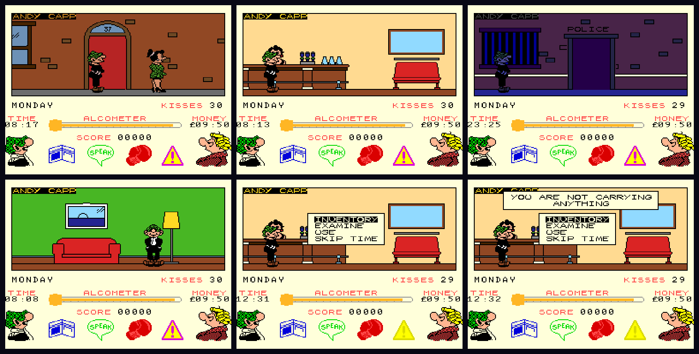

# Andy Capp for MSX2

**Mirrorsoft's 1987 game *Andy Capp*, which never had an MSX version, running on the MSX2: SCREEN 5 in full colour, a split palette for the street and the status panel, the Spectrum 128 music on the PSG, and the original gameplay intact.**

An unofficial homage port by **DiHalt Studio**, 2026.



## Play it

Download the game from the [Releases](../../releases) page: `andycapp-msx2.rom`, or the zip with the ROM and the two
manuals. It is a 512 KB ASCII16 MegaROM for an MSX2 (or MSX2+, or turbo R) with 64 KB of RAM and 128 KB of VRAM, in a
cartridge slot or on a flash cartridge. It works at 50 and at 60 Hz, at the same speed on both.

* **Real MSX:** a MegaROM flash cartridge with the ASCII16 mapper (for a MegaFlashROM SCC+ SD, see the
  [SD card](#megaflashrom-scc-sd) section).
* **openMSX:** load it with the mapper forced, because the automatic detection gets this ROM wrong:

```sh
openmsx -machine Philips_NMS_8250 -carta andycapp-msx2.rom -romtype ASCII16
```

or, with the source tree (it plays `release/andycapp-msx2.rom` when it is there):

```sh
make run          # Philips NMS 8250 (MSX2, 50 Hz)
make run60        # Panasonic FS-A1WSX (MSX2+, 60 Hz)
make run-turbor   # Panasonic FS-A1GT (MSX turbo R, 60 Hz)
```

The manual explains everything for a player: **[English](docs/manual/manual-en.pdf)** ·
**[Español](docs/manual/manual-es.pdf)**.

| Key / joystick (port 1 or 2) | Action |
|---|---|
| Cursor left / right, stick | walk |
| Cursor up, stick up | go through a door or turn a corner |
| Cursor down, stick down | blow a kiss |
| `SPACE`, fire button | open the icon bar, confirm, close a message |

It is Monday morning and Flo wants the giro. Raise the cash, mind the alcometer and the opening hours, and keep out of
the policeman's way.

### MegaFlashROM SCC+ SD

`make dist` writes `dist/`, a folder to copy to the root of the card: the ROM, `OPFXSD.COM`, the boot files of Nextor and
MSX-DOS and an `AUTOEXEC.BAT` that writes the game to the cartridge and starts it (`OPFXSD ANDYCAPP.ROM /A16 /X`). The
system files are third-party and are not in this repository: see [docs/BUILDING.md](docs/BUILDING.md).

## What is this?

*Andy Capp* was written for the ZX Spectrum (code by Blitter Animations, music by Jason C. Brooke). This port keeps the
original program **exactly as it was**, its logic, rooms, characters and timing, and replaces everything the Spectrum
hardware did with native MSX2 code:

* **SCREEN 5, 16 colours, two palettes in one picture.** The street and the status panel use different palettes: a line
  interrupt swaps them under the play area, and the vertical blank swaps them back, with variations of
  the play palette for dusk and night.
* **Colour art.** The 41 room pictures, the characters, the status panel and the window font are indexed PNG files,
  recoloured by hand from the black and white Spectrum graphics.
* **Native drawing.** Back buffer copies, sprites with transparency, windows and menus use the VDP's own commands.
* **Music during play.** The Spectrum 128 tune, played on the PSG, goes on through the game; the sound effects take one
  channel while they sound.
* **For the player.** Messages wait until you press fire, the time on the panel keeps running while a window is open,
  and the game starts without wrong colours.
* **Cover and logo** screens at 512x424 (SCREEN 7, interlaced) and a start-up logo.

The design, with the memory model, the rendering, the patches to the original program and the ROM layout, is in
**[docs/DESIGN.md](docs/DESIGN.md)**. The patches are listed one by one in [src/patches.py](src/patches.py): address,
expected original bytes, replacement and reason.

## Building from source

The port patches the original program, so building needs the **Spectrum original**, which is **not distributed here**
(the game belongs to its rights holders): its byte-identical reassembly and the tape bytes, in a folder named `ZX` next
to this one (`../ZX`). Details in [docs/BUILDING.md](docs/BUILDING.md).

You also need sjasm 0.42c (the classic SjAsm, not SjAsmPlus), Python 3 with Pillow and openMSX. `pdflatex` for the
manual.

```sh
make              # build/andycapp.rom
make release      # the same, copied to release/ with the manuals, plus a zip (the files of a GitHub release)
make dist         # dist/, the folder for a MegaFlashROM SCC+ SD card
make manual       # the PDFs of docs/manual/
make help         # everything else: palettes, previews...
```

## Repository layout

```text
src/            the MSX2 runtime and boot code, Z80 assembly (sjasm), and patches.py, the changes to the original
assets/         the editable art, indexed PNG (rooms, characters, status panel, window font, kiss, cover, logo) and the palettes
tools/          the ROM builder, art converters, palette tools, SD card folder, manual pictures, emulator scripts
docs/           DESIGN.md, the pictures, and the manual (LaTeX source and PDFs)
release/        where the release files go (not tracked)
```

[assets/README.md](assets/README.md) explains the art: palettes, sizes, and how to edit and preview it.

## Make it better

This project is meant to be played with, changed and improved. **Please improve the game if you feel so!** Some ideas:

* **Colour.** Every picture is a plain indexed PNG and every palette a `.gpl` file. Re-colour a room, a character, the
  night: [assets/README.md](assets/README.md).
* **Graphics.** Redraw the rooms, the characters, the panel or the cover.
* **Sound.** The tune is the Spectrum 128's, and a tracker could give it a richer MSX version (PSG, SCC).
* **Engine.** Pace the menus and the window animations by vertical blanks too, MSX2+ and turbo R features, a pause key.
* **Fixes and tests.** Found a glitch? Tell us how to reproduce it.

Fork it, change something and share what you made. Pull requests and issues are welcome.

## Credits and rights

* ***Andy Capp*** is a game by **Mirrorsoft**, 1987 (Blitter Animations; music by Jason C. Brooke). The Andy Capp
  characters are the creation of Reg Smythe and property of Mirror Group Newspapers. The game, its graphics, music and
  name belong to their rights holders. This is an unofficial port made for study, preservation and homage; it is not
  affiliated with them.
* **MSX2 port, graphics engine, colour art, tools, cover and logo screens, manual:** DiHalt Studio, 2026.
* MSX is a trademark of MSX Licensing Corporation.
* Built with [sjasm](http://www.xl2s.tk/) by Sjoerd Mastijn and [openMSX](https://openmsx.org/). `OPFXSD` is by Manuel
  Pazos; Nextor by Konamiman.
